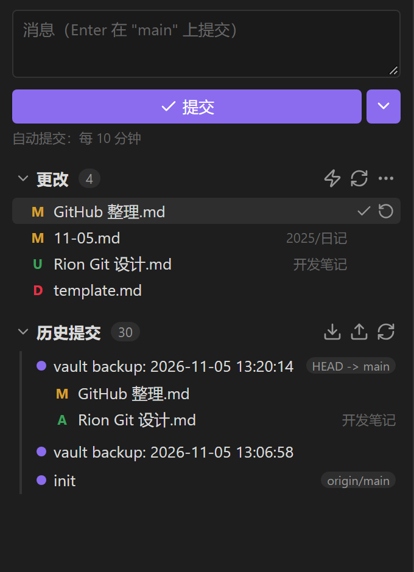
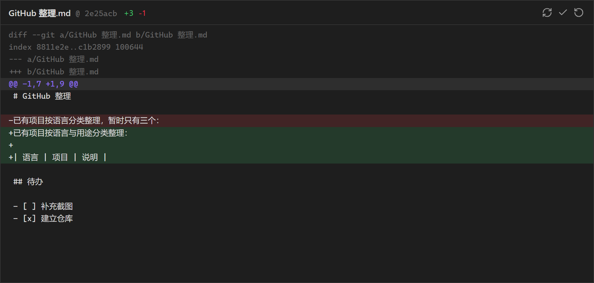

# Rion Git

English | [简体中文](./README.md)

A lightweight Git plugin for Obsidian: review changes in the sidebar, write a commit message, commit, push, pull — and see exactly what changed in any file.

Desktop only. It drives the Git you already have installed.

---

## Features

| Feature | Description |
|---|---|
| Sidebar panel | Change list, commit box and actions, close in spirit to VS Code's Source Control |
| Diff view | Click a file to open its diff in an **editor tab**, side by side with your notes |
| Per-file actions | Hover a file row to reveal "commit this file" and "discard changes" |
| History | Latest 30 commits; expand one to list its files, click a file to see that commit's diff |
| Push / pull | One click, with automatic upstream setup on first push |
| Smart auto-commit | Commits when changes reach a file-count or line-count threshold |
| Status bar | Always-visible change count and operation state; click to open the panel |

## Interface

Sidebar panel:

Diff view, opened in an editor tab when you click a file:

> These previews are rendered from the plugin's real DOM structure and `styles.css`, using Obsidian's default dark theme colours.

## Usage

### Open the panel

The panel opens automatically in the right sidebar when Obsidian starts (disable it in settings). If you closed it earlier, any of these reopens it:

- Click the `git-branch` icon in the ribbon
- Click the status bar item (`Git ✓` / `Git • 3`)
- Run "Rion Git: Open sidebar panel" from the command palette

### Commit changes

1. Type a message in the box at the top (leave empty to use the template from settings — default `vault backup: <timestamp>`)
2. Press `Enter` or click "✓ Commit"
3. To push right away, use the `⌄` caret and pick "Commit and push"

The message box clears on success while keeping focus, so you can keep going.

### Inspect and handle a single file

- **Click a file row** → opens the diff in a new editor tab, with `+N -M` in the header
- **Hover a file row** → two icons appear on the right:
  - `✓` commit only this file (other changes stay uncommitted)
  - `⟳` discard this file's changes (asks for confirmation first; untracked files get deleted)

### Browse history

- Click any entry under "History" to expand the list of files it touched
- Click a file there to see that commit's diff for it
- The pill on the right shows where a ref points, e.g. `HEAD -> main`, `origin/main`

### Push and pull

Use `⬇` (pull) and `⬆` (push) in the History section header, or the equivalent commands.

The first push sets up tracking automatically via `push -u origin <branch>`.

### Auto-commit

Three mutually exclusive modes:

| Mode | Trigger |
|---|---|
| Off | Manual commits only |
| Interval | Every N minutes (default 10) |
| Smart | When changes reach a threshold: **≥ N files** or **≥ N lines** |

Either smart threshold can be set to 0 to ignore that dimension; setting both to 0 is the same as off. Line counts include additions and deletions, and untracked new files contribute their own line count.

The `⚡` icon in the panel is a shortcut toggle: highlighted means on, and clicking cycles between "off" and the mode you used last.

Successful auto-commits are silent; only the status bar and panel update.

### Status bar

| Shows | Meaning |
|---|---|
| `Git ✓` | Working tree is clean |
| `Git • 3` | 3 uncommitted changes |
| `Git ⟳ Pushing…` | Operation in progress |
| `Git ⚠` | Error — hover for details |

## Settings

Settings → Community plugins → Rion Git

| Option | Default | Description |
|---|---|---|
| Git executable | `git` | If Obsidian launched from a shortcut can't find git, use an absolute path such as `C:\Program Files\Git\cmd\git.exe` |
| Commit message template | `vault backup: {{date}}` | `{{date}}` becomes `YYYY-MM-DD HH:mm:ss` |
| Auto-commit mode | Interval | Off / Interval / Smart — mutually exclusive |
| Auto-commit interval | 10 min | Interval mode only |
| Smart: changed-files threshold | 5 | Smart mode only; 0 = ignore file count |
| Smart: changed-lines threshold | 200 | Smart mode only; 0 = ignore line count |
| Push after auto-commit | Off | Requires a configured remote; backs off 5 minutes after a failure |
| Open panel on startup | On | Opens the panel in the right sidebar when Obsidian starts |
| Show status bar | On | Takes effect after reloading the plugin |

## Commands

| Command | Action |
|---|---|
| Open sidebar panel | Show the Rion Git panel |
| Commit all changes | Commit using the template message |
| Commit and push | Commit, then push |
| Push to remote | `git push` |
| Pull from remote | `git pull` (merge mode) |
| Show changes | Open a change list |
| Initialize repository | `git init` for this vault plus a default `.gitignore` |
| Refresh status | Re-read repository state |

## Technical notes

- **TypeScript + esbuild**, bundled into a single `main.js`; only `obsidian` and Node built-ins stay external.
- **Drives the system Git** through Node's `child_process.execFile`, with arguments passed as an array and never through a shell — so spaces and non-ASCII characters in paths survive intact. It also means your existing credential helper and SSH keys are reused; the plugin never stores passwords or tokens.
- **Layered design**: `git/exec.ts` is the only place that spawns a process, `git/ops.ts` translates an operation into git commands, and the UI only reads state and expresses intent. Supporting mobile later (via `isomorphic-git`) would be confined to that seam.
- **Serialized queue**: Git's `index.lock` is global, so every call is queued — this is what keeps auto-commit from colliding with a manual push.
- **Status parsing**: `git status --porcelain=v1 -z --untracked-files=all`, NUL-delimited, so filenames containing spaces, CJK characters or newlines stay correct.
- **Path encoding**: every git invocation passes `-c core.quotepath=false`; otherwise non-ASCII paths come back as octal escapes like `\346\225\264`.
- **UI**: both the sidebar panel and the diff view are custom Obsidian `ItemView`s (not modals), so they can be split, and they survive restarts.
- **Refresh strategy**: vault `modify/create/delete/rename` events are debounced (700 ms) and only trigger a status refresh; a 30-second poll covers changes made outside Obsidian. Auto-commits are still driven solely by the timer.

## Known limitations

- **Desktop only** — relies on a local git binary and Node APIs; `isDesktopOnly` is set in `manifest.json`.
- **Requires Git** to be installed, with `user.name` / `user.email` configured, or commits will fail.
- **Credentials** are managed by the system: run a `git push` in a terminal once to make sure your credential helper or SSH key works.
- **Conflicts** are detected and reported, but there is no one-click "keep mine / keep theirs" yet.
- No branch switching, merging, or per-hunk staging.
- Binary files and files above 2 MB get no diff preview.
- Avoid keeping the vault on a sync drive (OneDrive, iCloud) while using Git — syncing `.git` tends to corrupt the repository.

## License

MIT
