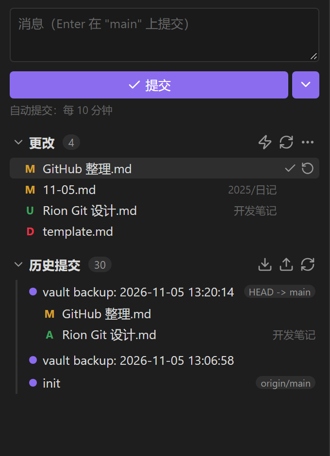
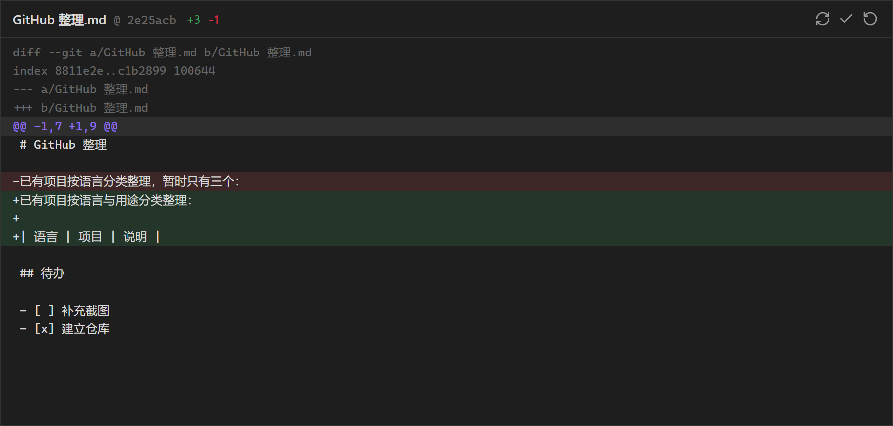

# Rion Git

简体中文 | [English](./README.en.md)

一个轻量的 Obsidian Git 插件：在侧边栏里查看改动、写提交信息、提交、推送、拉取，并且能直接看每个文件改了什么。

面向桌面端，调用你本机已安装的 Git。

---

## 功能

| 能力 | 说明 |
|---|---|
| 侧边栏面板 | 改动列表 + 提交框 + 操作按钮，风格接近 VS Code 的源代码管理面板 |
| 查看差异 | 点击文件在**编辑区标签页**打开 diff，可与其他笔记并排对照 |
| 单文件操作 | 悬停文件行出现「提交此文件」「撤销修改」两个图标 |
| 提交历史 | 最近 30 条提交，点击展开查看该提交改动的文件，再点文件看当时的差异 |
| 推送 / 拉取 | 一键操作，自动处理首次推送的 upstream 关联 |
| 定时自动提交 | 按设定间隔自动提交，可在面板上一键开关 |
| 状态栏 | 底部常驻显示改动数量与当前操作状态，点击打开面板 |

## 界面

侧边栏面板：

点击文件后在编辑区标签页打开的差异视图：

> 示意图由插件真实的 DOM 结构与 `styles.css` 渲染，配色取 Obsidian 默认深色主题。

## 使用

### 打开面板

Obsidian 启动后会自动在右侧边栏打开面板（可在设置里关掉）。如果之前手动关闭了，任选一种重新打开：

- 点击左侧边栏的 `git-branch` 图标
- 点击底部状态栏的 `Git ✓` / `Git • 3`
- 命令面板执行「Rion Git: 打开侧边栏面板」

### 提交改动

1. 在顶部输入提交消息（留空则使用设置里的模板，默认 `vault backup: <当前时间>`）
2. 按 `Enter` 或点「✓ 提交」
3. 想同时推送，点右侧 `⌄` 选择「提交并推送」

提交成功后消息框自动清空，光标留在原位，方便连续提交。

### 查看与处理单个文件

- **点击文件行** → 在编辑区新标签页打开 diff，增减行带颜色，标题栏显示 `+N -M`
- **悬停文件行** → 右侧出现两个图标：
  - `✓` 只提交这个文件（其他改动保持在未提交状态）
  - `⟳` 撤销这个文件的修改（会先弹确认框；未跟踪文件是直接删除）

### 查看历史

- 点「历史提交」里的任意一条 → 展开该提交改动的文件列表
- 再点其中的文件 → 显示该提交对这个文件的改动
- 右侧胶囊标签表示分支指向，例如 `HEAD -> main`、`origin/main`

### 推送与拉取

面板「历史提交」一栏右侧的 `⬇`（拉取）、`⬆`（推送），或命令面板执行对应命令。

首次推送没有远端跟踪分支时会自动 `push -u origin <当前分支>`。

### 定时自动提交

默认间隔 10 分钟，面板上的 `⚡` 是总开关：

- `⚡` 亮起 = 自动提交开启
- `⚡` 灰色 = 自动提交关闭，只保留手动操作

自动提交成功不会弹提示，只在状态栏和面板上更新改动数量。

### 状态栏

| 显示 | 含义 |
|---|---|
| `Git ✓` | 工作区干净 |
| `Git • 3` | 3 个待提交改动 |
| `Git ⟳ 推送中…` | 正在执行操作 |
| `Git ⚠` | 出错，悬停查看原因 |

## 设置

设置 → 第三方插件 → Rion Git

| 选项 | 默认 | 说明 |
|---|---|---|
| Git 可执行文件 | `git` | 如果从快捷方式启动 Obsidian 时找不到 git，填完整路径，例如 `C:\Program Files\Git\cmd\git.exe` |
| 提交消息模板 | `vault backup: {{date}}` | `{{date}}` 会替换为 `YYYY-MM-DD HH:mm:ss` |
| 启用自动提交 | 开 | 总开关 |
| 定时提交间隔 | 10 分钟 | 设为 0 即关闭定时提交 |
| 自动提交后推送 | 关 | 需要已配置远端；失败后暂停 5 分钟再试 |
| 启动时自动打开面板 | 开 | Obsidian 启动后自动在右侧边栏打开 |
| 显示状态栏 | 开 | 重载插件后生效 |

## 命令面板

| 命令 | 作用 |
|---|---|
| 打开侧边栏面板 | 显示 Rion Git 面板 |
| 提交全部改动 | 用模板消息提交 |
| 提交并推送 | 提交后立刻推送 |
| 推送到远端 | `git push` |
| 从远端拉取 | `git pull`（merge 模式） |
| 查看改动 | 弹出改动列表 |
| 初始化仓库 | 对当前 vault 执行 `git init`，并写入一份默认 `.gitignore` |
| 刷新状态 | 重新读取仓库状态 |

## 技术说明

- **TypeScript + esbuild**，打包为单个 `main.js`，只有 `obsidian` 和 Node 内置模块作为外部依赖。
- **直接调用系统 Git**：通过 Node 的 `child_process.execFile` 执行，参数以数组传递、不经过 shell，避免路径中的空格与中文被 shell 转义破坏。这也意味着插件会复用你已有的 credential helper 和 SSH key，插件本身不保存任何密码或令牌。
- **接口抽象**：`git/exec.ts` 是唯一 fork 进程的地方，`git/ops.ts` 负责把一次操作翻译成若干条 git 命令，UI 层只读状态、发意图。将来若要支持移动端（改用 `isomorphic-git`），替换面就在这里。
- **串行队列**：Git 的 `index.lock` 是全局的，所以所有调用都排队执行，避免「自动提交撞上手动推送」这类竞态。
- **状态解析**：`git status --porcelain=v1 -z --untracked-files=all`，用 NUL 分隔，正确处理带空格、中文、换行的文件名。
- **路径编码**：所有 git 调用都带 `-c core.quotepath=false`，否则中文路径会输出成 `\346\225\264` 这样的八进制转义。
- **界面**：侧边栏面板和差异视图都是 Obsidian 的自定义 `ItemView`（不是弹窗），因此可以分屏、可以被记住、重启后还原。
- **刷新策略**：监听 vault 的 `modify/create/delete/rename` 事件，合并 700ms 后只刷新状态；另有 30 秒轮询兜底，用于在终端里直接操作 git 的情况。自动提交仍然只由定时器触发，与文件事件无关。

## 已知限制

- **仅桌面端**：依赖本机 git 与 Node 能力，`manifest.json` 中标记了 `isDesktopOnly`。
- **需要自行安装 Git** 并配置好身份（`user.name` / `user.email`），否则提交会失败。
- **凭据**由系统管理：请先在终端完成一次 `git push`，确认 credential helper 或 SSH key 可用。
- **冲突**目前只能检测并提示，尚无「用本地 / 用远端」的一键处理。
- 暂不支持分支切换、合并、逐 hunk 暂存。
- 二进制文件、超过 2MB 的文件不出差异预览。
- 不建议把 vault 放在 OneDrive / iCloud 等同步盘里再用 Git，`.git` 目录被同步容易损坏。

## 许可证

MIT
